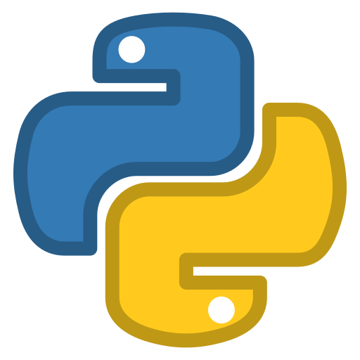
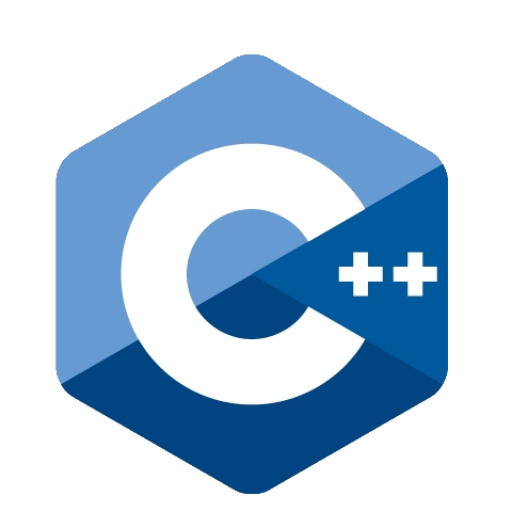
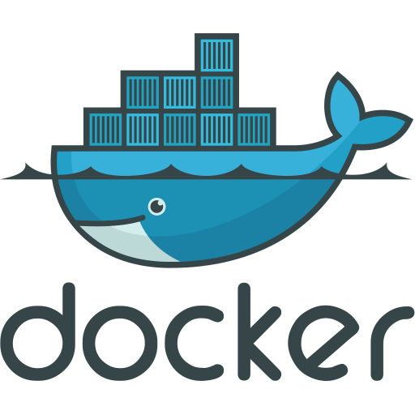
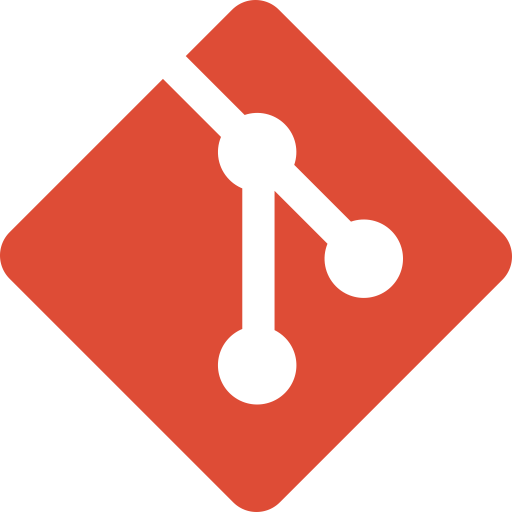

<h2 align="center">Hey, I'm Noel 👋</h2>

  <strong>Freelance Consultant — Build · Manage · Automate</strong>

---

### 🧑‍💻 About Me

I'm a Paris-based freelance consultant helping SaaS companies and SMBs ship products, streamline operations, and leverage AI.

With a Master's in Information Technology from **EPITECH** and international experience across France, Luxembourg, and Malaysia, I bring a unique blend of technical depth and project leadership to every engagement.

**What I do:**
- **Build** — Full-stack web & mobile development (React, Node, Swift, Python)
- **Manage** — End-to-end project management, from roadmap to delivery
- **Automate** — AI integration & workflow automation consulting

Previously: Project Management Consultant @ **Onepoint** | Partnerships @ **TechUp** | VivaTech & France Digitale

---

### 💻 Tech Stack

### 🛠️ Tools

---

### ⚡ GitHub Stats

---

### 📬 Let's Connect

  <a href="mailto:contact@noelvarga.com"><strong>contact@noelvarga.com</strong></a>

&nbsp;&nbsp;
&nbsp;&nbsp;

